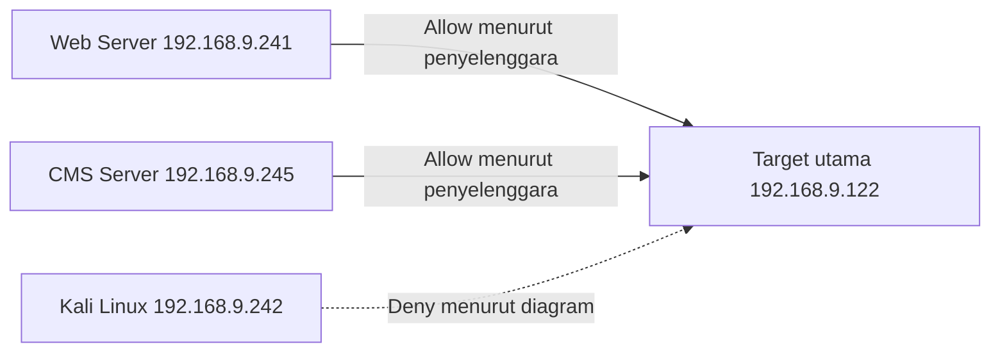

# Exam 03 — Enterprise Cyber Range

**Enterprise Cyber Range: Full-Stack Offensive Security Simulation Lab**  
**Program:** XCODE / HackersBootcamp Asia  
**Pembaruan dokumentasi:** 17 November 2026 (WIB)  
**Status:** IN PROGRESS — NOT SOLVED

[Indeks repository](../README.md) · [Panduan awal](XCODE_Exam_03_Guide.md) · [Evidence](evidence/README.md)

## 1. Overview

Exam 3 mempelajari keamanan web, autentikasi, Wi-Fi, Android, server, dan isolasi container dalam cyber range terdistribusi dengan kontrol jaringan Allow/Deny. Fokus dokumentasi saat ini adalah **HTTP Header Manipulation**. Hasil HTTP-01–HTTP-15 hingga 17 November 2026 dilengkapi HTTP-17 dari pesan lanjutan pengguna: root/listing dapat diakses, sedangkan akses admin tetap ditolak. HTTP-17 memperlihatkan dua redirect HTTPS → HTTP → HTTPS yang berakhir pada 403; tanggal eksekusinya belum diberikan. Authorization bypass belum terbukti.

Dokumentasi utama menggunakan bahasa Indonesia, folder `exam-03`, README sebagai indeks, dan judul bagian bernomor mengikuti Exam 1/2. Detail dipisahkan per challenge di `lab-*/README.md`, mengikuti pola Exam 1. Panduan awal tetap tersedia sebagai konteks perencanaan.

## 2. Scope dan aturan pembuktian

Alamat berikut berasal dari instruksi lab yang diberikan pengguna. Pencantuman alamat tidak membuktikan konektivitas, kerentanan, atau keberhasilan eksploitasi. Pembaruan ini hanya mengolah catatan; tidak menjalankan request ke target, active scanning, unduhan artefak, atau eksploitasi.

- **Observed:** observasi dalam laporan pengguna; tidak diuji ulang oleh maintainer. Tautan sumber dan keterbatasan ada di [register evidence](evidence/README.md).
- **Not Verified:** hipotesis atau informasi penyelenggara yang belum dikonfirmasi melalui pengujian.
- Jurnal HTTP menggunakan marker **OBSERVED**, **IMPORTANT**, **NOT VERIFIED**, dan **NEXT STEP** untuk memisahkan fakta, konsep, hipotesis, serta rencana; Observed/Not Verified pada catatan awal bermakna sama.
- **NOT STARTED:** belum ada hasil pengujian yang diberikan untuk challenge tersebut.
- **IN PROGRESS — NOT SOLVED:** ada pengujian, tetapi objective belum terbukti tercapai.

Konsep protokol, metode yang direncanakan, dan mitigasi adalah materi pembelajaran; bukan hasil uji target. Tidak ada challenge yang dinyatakan selesai. Kredensial, token, flag, dan bukti mentah sensitif tidak dipublikasikan.

## 3. Target Information dan indeks challenge

| ID | Challenge / dokumentasi | Target dari instruksi | Current Status |
|---|---|---|---|
| HDR-01 | [HTTP Header Manipulation](lab-01-http-header-manipulation/README.md) | `https://hackerlab.biz.id/target/ujian.php/secret-admin` | **IN PROGRESS — NOT SOLVED** |
| WIFI-01 | [Wi-Fi Password Cracking (WPA2 Handshake)](lab-02-wpa2-handshake/README.md) | `https://hackerlab.biz.id/wifi-01.cap` | NOT STARTED |
| JWT-01 | [JWT Authentication Testing](lab-03-jwt-authentication/README.md) | `https://app.hackerlab.biz.id/jwt.php` | NOT STARTED |
| MOB-01 | [Mobile Static and Dynamic Analysis](lab-04-mobile-analysis/README.md) | `https://hackerlab.biz.id/login.apk` | NOT STARTED |
| WEB-01 | [Web Server Remote Code Execution](lab-05-web-server-rce/README.md) | `192.168.9.241` | NOT STARTED |
| CMS-01 | [CMS Remote Code Execution](lab-06-cms-rce/README.md) | `192.168.9.245` | NOT STARTED |
| MAIN-01 | [Docker Container Escape](lab-07-docker-container-escape/README.md) | `192.168.9.122` | NOT STARTED |
| KALI | Kali Linux Lab (sumber akses) | `192.168.9.242` | Konektivitas: **Not Verified** |

Alamat lab di atas dicantumkan sesuai scope yang diminta pengguna. Jangan menambahkan identitas, alamat akses privat lain, atau rahasia dari sesi lab ke repository.

## 4. Arsitektur dan kontrol akses

**Not Verified — informasi penyelenggara:** target utama hanya dapat diakses melalui Web Server dan CMS Server yang memiliki jalur Allow. Jalur langsung dari Kali Linux diblokir menurut diagram. Layanan, port, route, dan keberhasilan akses aktual belum diverifikasi.



Diagram menyatakan kebijakan yang dilaporkan, bukan hasil reachability test. Akses pada satu host belum membuktikan akses pada host lain; root dalam container belum membuktikan root pada host.

## 5. Progres dan langkah berikutnya

| Tanggal | Sumber | Hasil yang tersedia | Batas kesimpulan |
|---|---|---|---|
| 17 November 2026 | [SRC-01](evidence/README.md#1-register-sumber) | **Observed:** HTTP-01–HTTP-08 seluruhnya 403 Forbidden | Belum ada bypass; sumber penolakan belum diketahui |
| Hingga 17 November 2026 | [SRC-03](evidence/README.md#1-register-sumber) | **OBSERVED:** HTTP-09–HTTP-15: root/parent 200, listing terlihat, admin 403, tanpa slash 301; ENV-01 mencatat masalah PATH | Redirect scheme tidak konsisten; konteks shell berbeda; dampak aktual belum terbukti |
| Tanggal eksekusi tidak diberikan; didokumentasikan 17 November 2026 | [SRC-04](evidence/README.md#1-register-sumber) | **OBSERVED:** HTTP-17: HTTPS HTTP/2 301 → HTTP HTTP/1.1 301 → HTTPS HTTP/2 403 | Dua redirect; akses ditolak; root cause/dampak hop HTTP **NOT VERIFIED** |

Gunakan [laporan HTTP](lab-01-http-header-manipulation/README.md) untuk findings F-01–F-07, [learning journal](lab-01-http-header-manipulation/TEST-LOG.md) untuk command/breakdown per test, dan [glosarium](lab-01-http-header-manipulation/GLOSSARY.md) untuk fundamentals serta hubungan dengan backend Java. HTTP-16 belum diberikan dan tidak dibuat-buat. Prioritas berikutnya adalah melengkapi raw request/response, metadata lingkungan, serta korelasi log proxy/origin. Lihat [next investigation HTTP](lab-01-http-header-manipulation/README.md#10-next-investigation). Challenge lain berisi rencana belajar, bukan langkah yang telah dijalankan.

## 6. Struktur dokumentasi

```text
exam-03/
├── README.md
├── XCODE_Exam_03_Guide.md
├── lab-01-http-header-manipulation/
│   ├── README.md
│   ├── TEST-LOG.md
│   └── GLOSSARY.md
├── lab-02-wpa2-handshake/README.md
├── lab-03-jwt-authentication/README.md
├── lab-04-mobile-analysis/README.md
├── lab-05-web-server-rce/README.md
├── lab-06-cms-rce/README.md
├── lab-07-docker-container-escape/README.md
└── evidence/README.md
```

Setiap challenge menyediakan Overview, Learning Objectives, Target Information, Tools, Methodology, Test Cases, Results, Evidence, Findings, Mitigation, Lessons Learned, dan Current Status. Tambahkan hasil hanya jika sumbernya tersedia, sertakan test ID, dan bedakan rencana dari observasi.

Progres terbaru HTTP-18: **OBSERVED:** parent PHP tetap HTTP/2 403 dengan header menyerupai browser; bypass belum terbukti. [Detail learning journal](lab-01-http-header-manipulation/TEST-LOG.md#http-18--browser-like-request-headers). X-Original-URL adalah **NEXT STEP**, belum dijalankan.
