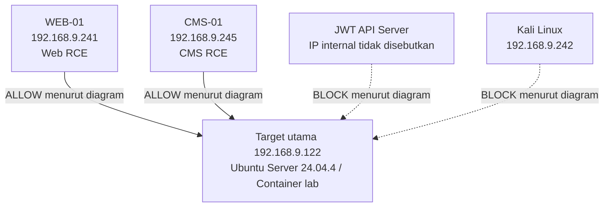

# XCODE Cybersecurity — Exam 03

**Program:** HackerBootcamp Asia — Enterprise Cyber Range  
**Tema:** Full-Stack Offensive Security Simulation & Docker Container Escape  
**Tanggal dokumentasi awal:** 14 November 2026  
**Pembaruan dokumentasi:** 17 November 2026 (WIB)  
**Status:** IN PROGRESS — NOT SOLVED; hasil HTTP-01–HTTP-15 dan HTTP-17 tersedia, challenge lain NOT STARTED

[Overview dan status terkini](README.md) · [Detail HTTP Header Manipulation](lab-01-http-header-manipulation/README.md) · [Register evidence](evidence/README.md)

[Learning journal HTTP](lab-01-http-header-manipulation/TEST-LOG.md) dan [glosarium](lab-01-http-header-manipulation/GLOSSARY.md) memuat detail pembelajaran tanpa menduplikasi command di panduan ini. Hasil historis hingga 17 November 2026 dipertahankan; tanggal eksekusi HTTP-17 belum diberikan. HTTP-16 tidak tersedia dalam laporan pengguna.

Panduan awal ini dipertahankan sebagai konteks perencanaan. Semua langkah/perintah di bawah adalah rencana, bukan bukti eksekusi. **Not Verified:** detail lingkungan, versi, prasyarat autentikasi, dan topologi dari informasi awal belum dikonfirmasi. Hasil **Observed** hanya dicatat pada dokumen HTTP dan register evidence berdasarkan laporan pengguna. Untuk status aktual setiap challenge, gunakan README Exam 3.

> Dokumen ini adalah peta pembelajaran dan jurnal pengujian **untuk aset lab yang secara eksplisit diizinkan**. Jangan menyamakan target yang tercantum dengan kerentanan yang telah terbukti. Hindari memasukkan password, token aktif, flag, identitas pengguna, atau bukti sensitif ke repo publik.

## 1. Tujuan dan gambaran umum

Exam 03 menggabungkan penilaian keamanan beberapa lapisan:

1. Wi-Fi/WPA2: menganalisis berkas *handshake* yang disediakan dan memahami pengujian ketahanan frasa sandi secara offline.
2. Web: mempelajari dampak manipulasi HTTP request header terhadap kontrol akses atau alur aplikasi.
3. API: mengevaluasi implementasi autentikasi dan otorisasi berbasis JWT.
4. Android: memeriksa aplikasi menggunakan static analysis dan dynamic analysis, termasuk indikasi SQL injection.
5. Web server: menilai apakah kelemahan aplikasi memungkinkan Remote Code Execution (RCE).
6. CMS: menilai potensi RCE pada CMS dan memperoleh akses lab yang terotorisasi jika memang terdapat kerentanan.
7. Jaringan internal/container: memahami isolasi jaringan, pivoting, dan kemungkinan rantai kelemahan container-to-host sesuai instruksi lab.

**Perbedaan dengan Exam 02:** penekanannya bukan hanya menjangkau host internal, tetapi juga memahami beberapa *attack surface*, kontrol *allow/deny*, perbedaan eksekusi dalam container dan pada host, dan dokumentasi bukti per tahap.

**Catatan administratif:** Pesan penyelenggara menyebut “Exam 3 — Hanya tambahan tidak masuk grup”. Ini dicatat sebagai informasi yang diterima, **bukan konfirmasi resmi tentang penilaian atau kriteria kelulusan**.

## 2. Inventaris aset dan scope

| ID | Target / berkas | Peran menurut instruksi | Akses / status yang diketahui |
|---|---|---|---|
| WIFI-01 | https://hackerlab.biz.id/wifi-01.cap | Capture WPA2 handshake | Berkas latihan, validitas handshake belum diperiksa |
| HDR-01 | https://hackerlab.biz.id/target/ujian.php/secret-admin | HTTP header exam | **OBSERVED:** resource terlindungi tetap ditolak; root/listing 200; HTTP-17 berakhir 403 setelah dua redirect; bypass belum terbukti |
| JWT-01 | https://app.hackerlab.biz.id/jwt.php | JWT authentication API | NOT STARTED; belum ada respons yang diberikan |
| JWT-LOGIN | https://app.hackerlab.biz.id/jwt.php/login | Endpoint login menurut panduan awal | **Not Verified:** prasyarat login; kredensial tidak dipublikasikan |
| MOB-01 | https://hackerlab.biz.id/login.apk | Android APK | Belum dianalisis/dieksekusi |
| WEB-01 | http://192.168.9.241 | Web server RCE lab | Salah satu sumber akses yang diizinkan ke target utama |
| CMS-01 | https://192.168.9.245 | CMS RCE lab | Salah satu sumber akses yang diizinkan ke target utama |
| KALI | 192.168.9.242 | Kali Linux bantuan | **Diblokir** menuju target utama menurut diagram; akses dari laptop ke Kali belum dikonfirmasi |
| MAIN-01 | 192.168.9.122 | Target utama (Ubuntu Server 24.04.4, container challenge) | Menurut instruksi **hanya dapat diakses dari WEB-01 dan CMS-01** |
| JWT-SERVER | Belum dinyatakan sebagai IP internal | JWT API pada diagram | Jalur langsung menuju MAIN-01 diblokir menurut diagram |

Alamat `192.168.9.0/24` adalah alamat privat. Status “Online” di dashboard penyelenggara tidak membuktikan laptop/hotspot/VPN dapat menjangkau IP tersebut.

## 3. Topologi dan model akses



> Diagram ini memodelkan **kebijakan akses menuju** target utama, bukan hasil pemindaian. Akses masih bergantung pada layanan, port, autentikasi, dan kondisi jaringan.

**Istilah penting:**

- **Entry point:** titik masuk awal yang dapat diakses dalam scope lab.
- **RCE (Remote Code Execution):** kemampuan menjalankan instruksi pada server melalui suatu kerentanan. RCE belum tentu memberikan shell interaktif.
- **Remote shell:** sesi yang memungkinkan eksekusi perintah dari jarak jauh pada lingkungan target sesuai izin proses.
- **Pivoting/lateral movement:** menggunakan server perantara yang sudah dapat diakses secara sah untuk menjangkau segmen lain yang dibatasi.
- **ACL (Access Control List):** aturan yang mengizinkan atau menolak suatu koneksi/aksi.
- **Container escape:** kondisi ketika isolasi container dapat dilanggar sehingga dapat memengaruhi lingkungan host. *Root dalam container tidak otomatis berarti root pada host.*
- **JWT (JSON Web Token):** token yang dapat membawa klaim seperti `sub`, `role`, `iat`, dan `exp`; isi token yang bisa didekode tidak berarti boleh dipercaya tanpa verifikasi tanda tangan dan klaim.

## 4. Masing-masing tantangan

### 4.1 WIFI-01 — WPA2 handshake

**Apa yang diuji:** pemahaman handshake WPA2-PSK, frame EAPOL, dan kekuatan kata sandi terhadap pengujian *offline dictionary* pada berkas capture yang telah disediakan.

**Langkah belajar:**

1. Unduh berkas `.cap` dari sumber penyelenggara ke lingkungan lab.
2. Validasi hash file (SHA-256), jenis berkas, dan ada/tidaknya frame EAPOL yang relevan.
3. Identifikasi SSID/BSSID dengan hati-hati dari capture; jangan menganggap handshake otomatis lengkap.
4. Jika cukup data dan diizinkan, uji kandidat kata sandi **secara offline**, bukan menarget jaringan Wi-Fi lain.
5. Simpan bukti berupa metadata capture, metode uji, dan hasil yang sudah disensor.

**Tools yang relevan:** Wireshark/tshark, `capinfos`, aircrack-ng, dan hashcat (sesuai format berkas/dukungan GPU).

**Kriteria selesai:** dapat menjelaskan apakah handshake cocok untuk analisis dan menunjukkan hasil uji yang valid, atau menjelaskan secara terukur mengapa belum dapat diperoleh hasil.

### 4.2 HDR-01 — HTTP Header Manipulation

**Status terkini:** IN PROGRESS — NOT SOLVED. **OBSERVED:** HTTP-01–HTTP-08 menghasilkan 403 pada histori 17 November 2026; hasil berikutnya mengungkap root/listing yang dapat diakses, masalah PATH, serta redirect HTTPS → HTTP → HTTPS pada HTTP-17 dengan hasil akhir 403. Lihat [test case, interpretasi, dan evidence](lab-01-http-header-manipulation/README.md) untuk rincian; daftar berikut tetap merupakan metode pembelajaran. Penyebab inkonsistensi redirect dan dampak keamanan aktual **NOT VERIFIED**.

**Apa yang diuji:** apakah aplikasi keliru mempercayai header dari client dalam proses routing, pengenalan identitas, atau otorisasi.

**Langkah belajar:**

1. Amati *baseline request/response* ke path `ujian.php/secret-admin`.
2. Catat status HTTP, header respons, redirect, cookie, dan isi respons yang relevan.
3. Identifikasi trust boundary: header dari browser/client berbeda dengan data yang ditetapkan reverse proxy yang dipercaya.
4. Uji perubahan **terbatas dan dalam scope** terhadap header yang sesuai petunjuk lab, lalu bandingkan respons dengan baseline.
5. Jangan menganggap perubahan kode status saja sebagai bukti akses admin; konfirmasikan *authorization outcome*.

**Tools:** `curl`, browser developer tools, Burp Suite Community atau OWASP ZAP.

### 4.3 JWT-01 — JWT Authentication/Authorization

**Contoh awal untuk rencana pengujian (Bash; belum dijalankan dalam pembaruan ini):**

```bash
curl -i 'https://app.hackerlab.biz.id/jwt.php'

curl -i -X POST 'https://app.hackerlab.biz.id/jwt.php/login' \
  -H 'Content-Type: application/json' \
  -d '{"username":"[LAB_USERNAME]","password":"[LAB_PASSWORD]"}'
```

**Apa yang diuji:** apakah server memvalidasi tanda tangan JWT, algoritma yang diizinkan, masa berlaku, issuer/audience jika relevan, dan peran pengguna pada server side.

**Langkah belajar:**

1. Catat respons endpoint GET dan login akun lab yang diberikan secara privat.
2. Jika ada token, pisahkan struktur `header.payload.signature` untuk inspeksi **tanpa menyimpulkan token aman hanya karena formatnya benar**.
3. Evaluasi klaim (`alg`, `typ`, `sub`, `role`, `exp`, `iss`, `aud`) yang benar-benar ada.
4. Identifikasi endpoint yang memerlukan otorisasi dan bandingkan akses anonymous vs akun lab.
5. Hanya dalam scope, validasi bahwa perubahan klaim/token tidak diterima tanpa pemeriksaan integritas/otorisasi yang tepat.

**Tools:** `curl`, `jq`, Burp Suite, decoder JWT offline. Hindari menempelkan token lab aktif ke situs publik.

### 4.4 MOB-01 — Android Static & Dynamic Analysis

**File:** `login.apk`.

**Static analysis:** memeriksa APK **tanpa menjalankannya**, misalnya manifest, permission, exported components, API URL, string sensitif, kode network, penggunaan SQLite, atau potensi query yang tidak aman.

**Dynamic analysis:** menjalankan aplikasi dalam emulator/lingkungan Android terisolasi lalu memperhatikan flow login, penyimpanan lokal, request/response jaringan, penanganan error, dan validasi backend.

**Fokus SQL injection:** temukan aliran input dari UI menuju backend/query, identifikasi apakah *parameterized query* dipakai, lalu buktikan dampaknya hanya dalam batas lab. Indikasi string/query pada dekompilasi **belum cukup** untuk menyatakan SQL injection.

**Tools:** Android emulator + ADB, JADX, apktool, MobSF, Burp Suite/OWASP ZAP. Jangan menginstal APK tidak dikenal pada ponsel utama.

### 4.5 WEB-01 — Web Server RCE

**Target:** `http://192.168.9.241`.

**Apa yang diuji:** bagaimana input aplikasi dapat mengakibatkan eksekusi kode/perintah pada server jika ada kerentanan. Materi mengarah pada “RCE into Remote Shell”, tetapi keberhasilannya **belum diverifikasi**.

**Tahapan:**

1. Konfirmasi konektivitas ke port HTTP dari jaringan lab.
2. Identifikasi halaman, teknologi, dan fungsi yang terlihat secara non-destruktif.
3. Cari kelemahan berdasarkan bukti perilaku dan versi teknologi (jika tersedia).
4. Bila sesuai scope dan aturan lab, buktikan RCE dengan efek minimum.
5. Identifikasi konteks proses yang diperoleh (`user`, host, apakah di dalam container) tanpa mengubah data yang tidak perlu.
6. Dokumentasikan apakah sumber WEB-01 benar-benar memiliki jalur ke MAIN-01.

### 4.6 CMS-01 — CMS Core RCE

**Target:** `https://192.168.9.245`.

**Apa yang diuji:** pengenalan jenis dan versi CMS, pencocokan terhadap sumber kerentanan yang dapat diverifikasi, dan pembuktian dampak RCE jika memang cocok dengan instalasi lab.

**Tahapan:**

1. Konfirmasi akses HTTPS dan catat persoalan sertifikat, jika ada.
2. Identifikasi CMS dan versi **tanpa mengasumsikan** nama produk dari istilah “Popular CMS”.
3. Cocokkan informasi produk/versi dengan advisori resmi; pertimbangkan kebutuhan autentikasi.
4. Validasi secara terukur sesuai aturan lab; jangan menjalankan eksploit yang tidak cocok hanya karena ada PoC di internet.
5. Jika memperoleh akses lab yang sah, catat konteks proses dan konektivitas ke MAIN-01.

### 4.7 MAIN-01 — Container-to-Host Escape Chain

**Target utama:** `192.168.9.122`, disebut menggunakan Ubuntu Server 24.04.4.

**Dependensi:** menurut diagram, MAIN-01 hanya bisa dijangkau dari WEB-01 atau CMS-01; karena itu jalur awal kemungkinan menjadi bagian penting dari skenario utama.

**Apa yang diuji:** memahami perbedaan akses aplikasi, shell proses, namespace dan isolasi container, hak istimewa pada container, serta dampak jika isolasi dengan host gagal.

**Urutan konsep:**

`Initial Access → eksekusi pada WEB-01/CMS-01 → akses internal ke MAIN-01 → identifikasi lingkungan container → analisis konfigurasi/kerentanan → verifikasi dampak pada host (jika sah dan terbukti)`

**Sangat penting:** frasa “From CVE-2026 to Host Container Escape Chain” **bukan nomor CVE lengkap**. Nomor CVE yang dapat ditelusuri harus memiliki bentuk seperti `CVE-2026-NNNN...`; jangan mengarang ID, exploit, atau mengasumsikan Ubuntu/Docker pasti rentan. Detail kerentanan harus dikonfirmasi dari versi komponen dan advisori resmi.

## 5. Urutan pengerjaan yang direkomendasikan

| Fase | Pekerjaan | Alasan | Bukti akhir |
|---|---|---|---|
| 0 | Verifikasi izin, scope, konektivitas, unduh artefak | Menghindari asumsi status online dan salah target | Catatan koneksi + SHA-256 |
| 1 | HTTP Header & JWT | Cepat untuk memahami HTTP, authn/authz | Baseline dan respons tersensor |
| 2 | WPA2 capture | Dapat dikerjakan offline tanpa akses IP internal | Metadata capture dan hasil analisis |
| 3 | APK static, kemudian dynamic analysis | Butuh pemetaan aplikasi sebelum uji runtime | Daftar komponen dan request flow |
| 4 | WEB-01 / CMS-01 | Dua kemungkinan entry point ke jalur utama | Temuan tervalidasi dan konteks akses |
| 5 | Jalur dari WEB-01/CMS-01 ke MAIN-01 | Menguji kebijakan allow/deny dalam lab | Matriks reachability dari sumber berbeda |
| 6 | Container & host validation | Tahap dengan dampak tertinggi, setelah prasyarat jelas | Bukti terukur dan analisis risiko |
| 7 | Review temuan, redaksi secret, rekomendasi mitigasi | Dokumentasi dapat dipertanggungjawabkan | Laporan akhir |

Fase 1–3 umumnya independen dari fase 4–6. Prioritas dapat diubah bila penyelenggara memberikan batas waktu atau kriteria kelulusan yang lebih spesifik.

## 6. Pemeriksaan awal non-destruktif

**Dari Windows PowerShell** (jalankan hanya jika perangkat berada di jaringan/VPN lab):

```powershell
Test-NetConnection 192.168.9.241 -Port 80
Test-NetConnection 192.168.9.245 -Port 443
```

`TcpTestSucceeded: False` dapat disebabkan route/VPN, firewall, target, atau port tertentu; itu **bukan** bukti kerentanan ataupun berarti seluruh host offline.

**Dari Bash** untuk baseline API yang sudah diberikan:

```bash
curl -i 'https://app.hackerlab.biz.id/jwt.php'
curl -i 'https://hackerlab.biz.id/target/ujian.php/secret-admin'
```

**Metadata artefak lokal** (Linux):

```bash
sha256sum wifi-01.cap login.apk
file wifi-01.cap login.apk
```

Catat tanggal, lingkungan, IP sumber, apakah VPN aktif, serta sensor cookies/token di log. Jangan mengabaikan error sertifikat TLS tanpa memverifikasi bahwa sertifikat memang milik lab.

## 7. Template log pengujian

Salin bagian berikut untuk setiap langkah:

```markdown
### [TEST-ID] Judul pengujian
- Tanggal dan zona waktu: YYYY-MM-DD HH:mm WIB
- Scope / target:
- Tujuan:
- Prasyarat / titik akses:
- Perintah / tindakan: (sensor rahasia)
- Ekspektasi:
- Hasil faktual: (status, waktu, kode respons, output tersensor)
- Bukti: `evidence/<nama-file>`
- Interpretasi:
- Keterbatasan / alternatif penjelasan:
- Dampak keamanan jika tervalidasi:
- Rekomendasi mitigasi:
- Status: NOT STARTED / IN PROGRESS / VERIFIED / INCONCLUSIVE
```

**Kategori temuan:** `Observation` (baru diamati), `Hypothesis` (dugaan), `Verified Finding` (terbukti), `Not Reproducible` (belum terbukti). Jangan langsung menaikkan dugaan menjadi kerentanan.

## 8. Susunan repo yang digunakan

```text
xcode-cybersecurity/
└── exam-03/
    ├── README.md
    ├── XCODE_Exam_03_Guide.md
    ├── lab-01-http-header-manipulation/
    │   ├── README.md
    │   ├── TEST-LOG.md
    │   └── GLOSSARY.md
    ├── lab-02-wpa2-handshake/README.md
    ├── lab-03-jwt-authentication/README.md
    ├── lab-04-mobile-analysis/README.md
    ├── lab-05-web-server-rce/README.md
    ├── lab-06-cms-rce/README.md
    ├── lab-07-docker-container-escape/README.md
    └── evidence/README.md
```

**Rekomendasi `.gitignore` untuk repo publik**:

```gitignore
# Sensitive lab artifacts and raw evidence
exam-03/**/*.cap
exam-03/**/*.pcap
exam-03/**/*.pcapng
exam-03/**/*.apk
exam-03/**/*token*
exam-03/**/*secret*
exam-03/**/*credential*
exam-03/evidence/raw/
```

Aturan `.gitignore` tidak menghapus file yang sudah pernah di-*commit*. Jika pernah terpublikasi, lakukan penanganan kebocoran dan pembersihan riwayat secara terpisah sesuai kebutuhan.

## 9. Checklist progres

- [ ] Konfirmasi scope dan aturan penyelenggara
- [ ] Verifikasi akses jaringan lab (jangan hanya mengandalkan dashboard)
- [ ] Simpan metadata WPA2 `.cap`
- [x] Catat baseline HTTP Header Exam dari laporan pengguna (raw evidence belum tersedia)
- [ ] Dokumentasi baseline JWT API (akun lab)
- [ ] Static analysis `login.apk`
- [ ] Dynamic analysis aplikasi dalam emulator
- [ ] Identifikasi service dan potensi jalur RCE pada WEB-01
- [ ] Identifikasi CMS/versi dan potensi jalur RCE pada CMS-01
- [ ] Verifikasi jalur yang diizinkan menuju MAIN-01
- [ ] Analisis keamanan container/host berdasarkan bukti
- [ ] Review risiko dan mitigasi
- [ ] Redaksi bukti serta rapikan dokumentasi publik

## 10. Referensi konsep

- [OWASP WSTG — Testing JSON Web Tokens](https://wstg.owasp.org/latest/4-Web_Application_Security_Testing/06-Session_Management/10-JSON_Web_Tokens/)
- [OWASP MASTG — Mobile App Security Testing](https://mas.owasp.org/MASTG/0x04b-Mobile-App-Security-Testing/)
- [OWASP MASVS — Verification Standard](https://mas.owasp.org/MASVS/03-Using_the_MASVS/)

---

**Status dokumen:** panduan perencanaan yang diperbarui dengan tautan progres HTTP; IN PROGRESS — NOT SOLVED. Tidak ada vulnerability confirmed. Semua hasil teknis selanjutnya harus disertai observasi dan bukti dari lingkungan lab.

Progres terbaru HTTP-18: **OBSERVED:** parent PHP tetap HTTP/2 403 dengan header menyerupai browser; bypass belum terbukti. [Detail learning journal](lab-01-http-header-manipulation/TEST-LOG.md#http-18--browser-like-request-headers). X-Original-URL adalah **NEXT STEP**, belum dijalankan.
