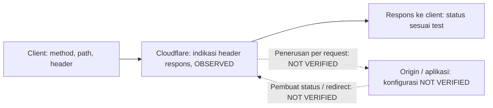
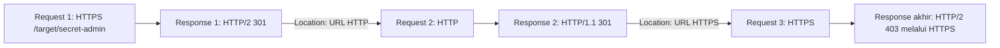

# Lab 01 — HTTP Header Manipulation

[Overview Exam 3](../README.md) · [Learning journal](TEST-LOG.md) · [Glosarium](GLOSSARY.md) · [Register evidence](../evidence/README.md)

**Challenge ID:** HDR-01  
**Hasil historis:** hingga 17 November 2026; tanggal eksekusi HTTP-17 tidak diberikan  
**Pembaruan dokumentasi:** 17 November 2026 (WIB)  
**Current Status:** IN PROGRESS — NOT SOLVED

## 1. Overview

Lab mengevaluasi kontrol akses HTTP dan kemungkinan aplikasi mempercayai header yang dikendalikan client. **OBSERVED:** endpoint utama dan direktori admin menolak request yang dilaporkan. Root dan `/target/` dapat diakses; listing mengungkap nama resource. HTTP-17 menunjukkan dua redirect pada path admin tanpa slash: HTTPS menuju HTTP, kemudian kembali ke HTTPS sebelum respons akhir 403. Authorization bypass belum terbukti.

Dokumen ini berfungsi sebagai laporan teknis; [TEST-LOG.md](TEST-LOG.md) memuat learning journal dan command aktual per test, sedangkan [GLOSSARY.md](GLOSSARY.md) menjelaskan konsep dan opsi command. Seluruh hasil berasal dari laporan pengguna, bukan pengujian ulang oleh maintainer. Tidak ada request ke target, scanning, atau eksploitasi yang dijalankan untuk pembaruan dokumentasi.

## 2. Learning Objectives

- Memahami method, URL/path, request/response header, status, body, dan redirect chain.
- Memisahkan header client dari metadata trusted proxy serta authentication dari authorization.
- Membandingkan path/method/header tanpa menyamakan listing atau redirect dengan akses admin.
- Memahami PATH Linux, konteks shell, dan keterbatasan perbandingan lintas lingkungan.
- Menelusuri hasil ke evidence dan membedakan fakta dari hipotesis konfigurasi.

## 3. Target Information dan scope

| Komponen | Nilai / cakupan |
|---|---|
| Endpoint challenge utama | `https://hackerlab.biz.id/target/ujian.php/secret-admin` |
| Parent PHP endpoint | `/target/ujian.php` |
| Root dan direktori pembanding | `/` dan `/target/` |
| Direktori admin | `/target/secret-admin` dan `/target/secret-admin/` |
| Method yang dilaporkan | GET, HEAD, OPTIONS |
| Histori tersedia | HTTP-01–HTTP-15, HTTP-17, dan ENV-01 |
| Batas pembaruan | Dokumentasi dari output yang diberikan; tidak ada pengujian aktif baru |

Path `/target/ujian.php/secret-admin` berbeda dari `/target/secret-admin/`; kesamaan nama tidak membuktikan handler yang sama. **NOT VERIFIED:** state autentikasi, IP sumber, route, dan konfigurasi server/proxy per request. HTTP-16 belum diberikan dan tidak dibuat sebagai test atau hasil sintetis.

## 4. Tools dan konsep dasar

Tool aktual pada command yang diberikan: curl dan Bash/Linux. ENV-01 mencatat curl ditemukan pada `/usr/bin/curl` dengan versi `8.20.0` setelah koreksi PATH dalam sesi Kali yang dilaporkan. Jangan menggeneralisasi versi tersebut ke root shell container atau semua test lain. Browser digunakan untuk observasi awal. Burp Suite/OWASP ZAP tetap merupakan opsi belajar, tanpa klaim telah digunakan.

Lihat [fundamentals](GLOSSARY.md) untuk HTTP GET/HEAD/OPTIONS, status, header, directory listing/traversal, Apache, Cloudflare, authentication/authorization, TLS termination, dan relevansi Spring Boot/Spring Security. Konsep dan rekomendasi bukan identifikasi implementasi target.

## 5. Methodology

Histori awal mencatat baseline, pergantian method/header, parent endpoint, dan OPTIONS. Pengujian berikutnya membandingkan root, listing, akses direktori, ukuran body, serta trailing slash. HTTP-17 melaporkan chain redirect yang diikuti; command reproduksi pada jurnal memakai `-L`, tetapi command aslinya belum diberikan. HTTP-14 hanya menampilkan respons pertama.

### Aturan pembuktian

- **OBSERVED:** tercantum pada hasil aktual yang diberikan pengguna; tidak diverifikasi ulang secara independen.
- **IMPORTANT:** konsep atau batas interpretasi yang perlu dipahami.
- **NOT VERIFIED:** hipotesis tanpa bukti yang cukup.
- **NEXT STEP:** rencana investigasi yang belum dijalankan.

Penanda Observed/Not Verified pada catatan awal memiliki makna yang sama. Cuplikan header yang diberikan dapat ditampilkan, tetapi header/body yang hilang tidak diisi dengan asumsi. Hasil HTTP-13 berasal dari root shell container setelah percobaan Kali gagal menemukan curl. Koreksi newline command dicatat di jurnal. HTTP-17 tidak memiliki metadata lingkungan atau tanggal eksekusi; tanggal pembaruan dokumen bukan tanggal uji yang diasumsikan.

### Model trust boundary

Diagram adalah model konseptual, bukan hasil tracing internal. Header `server: cloudflare` tidak menentukan pembuat 403/301. Footer Apache juga tidak menetapkan sumber penolakan. Penjelasan kemungkinan 403 edge/origin tersedia di [Cloudflare Error 403](https://developers.cloudflare.com/support/troubleshooting/http-status-codes/4xx-client-error/error-403/).

## 6. Test Cases dan command aktual

Gunakan [learning journal](TEST-LOG.md) sebagai satu lokasi command dan penjelasan per test. Setiap entri berisi Objective, Command, Command Breakdown, Actual Result, Technical Explanation, Important Findings, dan Conclusion. Tidak ada duplikasi blok command di laporan ini.

| Kelompok | Entri jurnal |
|---|---|
| Baseline / header / method | [HTTP-01](TEST-LOG.md#http-01--baseline-get), [HTTP-02](TEST-LOG.md#http-02--head-request), [HTTP-03](TEST-LOG.md#http-03--x-forwarded-for), [HTTP-04](TEST-LOG.md#http-04--x-real-ip), [HTTP-05](TEST-LOG.md#http-05--referer), [HTTP-06](TEST-LOG.md#http-06--parent-php-endpoint), [HTTP-07](TEST-LOG.md#http-07--options-method), [HTTP-08](TEST-LOG.md#http-08--accept-header) |
| Path / listing / perbandingan | [HTTP-09](TEST-LOG.md#http-09--root-endpoint), [HTTP-10](TEST-LOG.md#http-10--target-directory), [HTTP-11](TEST-LOG.md#http-11--directory-listing), [HTTP-12](TEST-LOG.md#http-12--direct-secret-admin-directory-access), [HTTP-13](TEST-LOG.md#http-13--status-and-body-size-comparison) |
| Slash dan redirect | [HTTP-14](TEST-LOG.md#http-14--secret-admin-without-trailing-slash), [HTTP-15](TEST-LOG.md#http-15--secret-admin-with-trailing-slash), [HTTP-17](TEST-LOG.md#http-17--complete-redirect-chain-analysis) |
| Lingkungan shell | [ENV-01](TEST-LOG.md#env-01--kali-linux-path-issue) |

[HTTP-20 ? SHA-256 Response Body Comparison](TEST-LOG.md#http-20--sha-256-response-body-comparison) melengkapi jurnal dengan dua command aktual dan batas interpretasi hash. HTTP-19 belum diberikan.

[HTTP-21 - X-Rewrite-URL Header Testing](TEST-LOG.md#http-21--x-rewrite-url-header-testing) mencatat respons 200 halaman pendaftaran dan verifikasi hash; tabel perbandingan baseline serta kedua routing header tersedia pada entri tersebut.

[HTTP-22 - HTML Source Inspection](TEST-LOG.md#http-22--html-source-inspection) mencatat hasil pencarian listing. [HTTP-23](TEST-LOG.md#next-planned-test--http-23) masih rencana, tanpa hasil.

## 7. Results

Seluruh baris hasil berikut adalah **OBSERVED** dari [SRC-01, SRC-03, dan SRC-04](../evidence/README.md#1-register-sumber). Tabel merupakan ringkasan; jurnal menyimpan command dan detail tanpa mengarang raw transcript.

| ID | Test case | Hasil aktual | Evidence |
|---|---|---|---|
| HTTP-01 | Baseline GET endpoint utama | HTTP/2 403 Forbidden | E-HDR-02, E-HDR-05 |
| HTTP-02 | HEAD endpoint utama | HTTP/2 403 Forbidden | E-HDR-02, E-HDR-05 |
| HTTP-03 | `X-Forwarded-For: 127.0.0.1` | HTTP/2 403 Forbidden | E-HDR-02, E-HDR-05 |
| HTTP-04 | `X-Real-IP: 127.0.0.1` | HTTP/2 403 Forbidden | E-HDR-02, E-HDR-05 |
| HTTP-05 | `Referer: https://hackerlab.biz.id/` | HTTP/2 403 Forbidden | E-HDR-02, E-HDR-05 |
| HTTP-06 | GET `/target/ujian.php` | HTTP/2 403 Forbidden | E-HDR-02, E-HDR-05 |
| HTTP-07 | OPTIONS endpoint utama | HTTP/2 403; tidak ditemukan `Allow` | E-HDR-04, E-HDR-05 |
| HTTP-08 | `Accept: application/json` | HTTP/2 403; Content-Type tetap HTML UTF-8 | E-HDR-05 |
| HTTP-09 | GET `/`, body dibuang lokal | HTTP/2 200 OK | E-HDR-06 |
| HTTP-10 | GET `/target/`, body dibuang lokal | HTTP/2 200 OK | E-HDR-06 |
| HTTP-11 | GET `/target/`, tampilkan body | HTTP/2 200; directory listing dan footer Apache | E-HDR-07 |
| HTTP-12 | GET `/target/secret-admin/` | HTTP/2 403; body `403 Forbidden` | E-HDR-08 |
| HTTP-13 | Loop tiga path di root shell container | `/`: 200 / 2766 bytes; `/target/`: 200 / 1150 bytes; admin dengan slash: 403 / 13 bytes; redirect URL kosong pada ketiganya | E-HDR-09 |
| HTTP-14 | GET direktori admin tanpa slash | HTTP/2 301; Location ke HTTP dengan slash, tautan body ke HTTPS | E-HDR-10 |
| HTTP-15 | GET direktori admin dengan slash, melalui HTTPS | HTTP/2 403; Content-Length 13; body `403 Forbidden` | E-HDR-11 |
| HTTP-17 | Rantai redirect path admin tanpa slash | HTTPS HTTP/2 301 → HTTP HTTP/1.1 301 → HTTPS HTTP/2 403; dua redirect | E-HDR-13 |
| HTTP-18 | User-Agent Mozilla/5.0 dan Accept HTML pada parent PHP | HTTP/2 403; body 13 bytes; Server-Timing tercatat; belum ada bypass | E-HDR-14 |
| HTTP-20 | Root GET baseline vs X-Original-URL, hash body | SHA-256 identik; perubahan konten tidak terdeteksi; status/header tidak diberikan | E-HDR-15 |
| HTTP-21 | Root dengan X-Rewrite-URL dan verifikasi SHA-256 | 200 OK, text/html, cloudflare, DYNAMIC; halaman Pendaftaran VPS Ujian; digest identik dengan baseline HTTP-20 | E-HDR-16 |
| HTTP-22 | Pencarian pola pada HTML `/target/` | Baris 12: `secret-admin/`; baris 13: `ujian.php`; tidak ada petunjuk header tambahan dalam hasil pencarian | E-HDR-17 |
| ENV-01 | PATH Kali dan verifikasi curl | Error awal `curl: command not found`; setelah koreksi: `/usr/bin/curl`, versi `8.20.0` | E-HDR-12 |

### Catatan historis dan batas karakteristik respons

SRC-01 melaporkan HTTP/2, 403, `server: cloudflare`, `content-type: text/html; charset=UTF-8`, `cf-cache-status: DYNAMIC`, body `403 Forbidden`, dan `content-length: 13` pada GET yang diamati (E-HDR-03). Ini bukan klaim seluruh header identik pada setiap test. SRC-03 kemudian menyediakan command aktual serta detail spesifik HTTP-08, HTTP-14, dan HTTP-15. Observasi browser 403 tetap tercatat sebagai E-HDR-01.

Ukuran body HTTP-13 bukan ukuran keseluruhan response/network traffic dan tidak membuktikan kesamaan byte body. Versi HTTP loop tidak tercantum pada output metrik. Redirect URL kosong hanya berlaku pada tiga path yang diuji dalam loop tersebut.

## 8. Evidence

[Register evidence](../evidence/README.md) mempertahankan SRC-01/SRC-02 dan menambahkan SRC-03/SRC-04. HTTP-17 didokumentasikan pada 17 November 2026; tanggal/jam pengujiannya tidak diberikan. Screenshot, header lengkap semua request, state sesi, log origin/edge, dan metadata jaringan belum tersedia. Cuplikan header aktual dipertahankan dalam jurnal; tidak ada screenshot, credential, flag, atau bukti keberhasilan yang dibuat.

## 9. Findings dan keterbatasan

| ID | Klasifikasi | Temuan | Dasar dan keterbatasan |
|---|---|---|---|
| F-01 | **OBSERVED** | Root dan `/target/` dapat diakses | HTTP-09–HTTP-11, HTTP-13; terbatas pada konteks yang dilaporkan |
| F-02 | **OBSERVED** | Directory listing mengungkap `secret-admin/` dan `ujian.php` | HTTP-11; tidak membuktikan akses isi direktori atau source PHP |
| F-03 | **OBSERVED** | Endpoint yang diuji sebagai resource terlindungi tetap menolak akses | HTTP-01–HTTP-08, HTTP-12/15, hasil akhir HTTP-17; pembuat 403 belum diketahui |
| F-04 | **OBSERVED** | Header client yang diuji belum mengubah hasil authorization menjadi akses diizinkan | HTTP-03–HTTP-05/08; bukan penilaian semua kemungkinan header |
| F-05 | **OBSERVED** | Path admin tanpa slash menghasilkan 301, dengan slash melalui HTTPS menghasilkan 403 | HTTP-14/15; HTTP-17 melengkapi chain yang kini diamati |
| F-06 | **OBSERVED** | Redirect HTTPS ke HTTP lalu kembali ke HTTPS sebelum 403 | HTTP-14 dan HTTP-17; dua redirect teramati, dampak keamanan aktual belum terbukti |
| F-07 | **OBSERVED** | Kali shell yang mengalami masalah PATH berbeda dari root shell container tempat loop berhasil | HTTP-13, ENV-01; bukan bukti akses root pada target lab |

### Rantai redirect terbaru — HTTP-17

**OBSERVED:** dua redirect muncul sebelum respons akhir; HTTP/2 terlihat pada respons awal/akhir dan HTTP/1.1 pada respons perantara. **IMPORTANT:** istilah “HTTP 403” menyebut status respons, bukan perpindahan scheme ke HTTP. Request terakhir memakai HTTPS; 403 tersebut diterima melalui HTTPS. Redirect bukan authorization bypass.

**NOT VERIFIED:** pembuat 301/403, konfigurasi canonical URL/forwarded scheme yang menyebabkan chain, maupun dampak keamanan aktual pada data, cookie, atau sesi. Cloudflare pada header dan Apache pada footer tidak cukup untuk mengatribusikan keputusan. Tidak ada bukti exploit, kebocoran secret, host compromise, atau bypass. Belum ada dasar severity/CVSS untuk klaim exploitable downgrade.

Temuan awal OBS-HDR-01–03 dipertahankan substansinya pada F-03/F-04 dan catatan Results. Hipotesis awal HYP-HDR-01 (penolakan edge), HYP-HDR-02 (penolakan origin), dan HYP-HDR-03 (header dinormalisasi/diabaikan) tetap **NOT VERIFIED**. Kode status sama tidak membuktikan jalur internal sama; OPTIONS 403 tanpa Allow tidak menyimpulkan method tidak didukung.

HTTP-18 melengkapi F-03/F-04: hasil tetap 403 dibanding HTTP-06 pada path yang sama. Dua header diubah sekaligus, sehingga pengaruh masing-masing tidak dapat dipisahkan. Lihat [jurnal HTTP-18](TEST-LOG.md#http-18--browser-like-request-headers) untuk output aktual dan batas interpretasi Server-Timing.

## 10. Next Investigation

Seluruh langkah berikut merupakan **NEXT STEP**, belum dijalankan oleh maintainer:

1. Lengkapi raw request/response dan metadata per test, termasuk tanggal/jam serta lingkungan HTTP-17. Pertahankan hasil historis dan hindari menggeneralisasi versi curl atau IP sumber lintas shell.
2. Tinjau konfigurasi redirect/canonical URL, TLS termination, dan header scheme dari proxy bersama pengelola. **NOT VERIFIED:** informasi scheme yang salah atau penulisan ulang respons menyebabkan redirect pertama ke HTTP.
3. Korelasikan ID request dan timestamp dengan event Cloudflare serta log Apache/aplikasi origin untuk mengidentifikasi pembuat masing-masing 301/403. Jangan menganggap banner menentukan root cause.
4. Nilai dampak hop HTTP menggunakan bukti konfigurasi dan kebijakan client/cookie/HSTS yang disediakan secara aman. **NOT VERIFIED:** data sensitif benar-benar terkirim pada hop tersebut; jangan menyimpulkan kebocoran dari chain saja.
5. Evaluasi kebutuhan directory listing dan kontrol akses per resource, lalu review trusted proxy serta prasyarat authentication/authorization. Keberhasilan hanya boleh dinyatakan jika akses terlindungi benar-benar terbukti.

**NEXT STEP ? rencana, belum dijalankan:** uji X-Original-URL untuk menilai pengaruh client-controlled routing header terhadap request processing. Tentukan nilai header dan endpoint pembanding dalam scope, pertahankan baseline, dan rekam respons. Belum ada hasil atau bypass yang diklaim untuk rencana ini.

**Pembaruan rencana setelah HTTP-20:** perbandingan body dengan X-Original-URL kini tersedia; rencana sebelumnya dipertahankan sebagai histori. **NEXT STEP:** uji X-Rewrite-URL terhadap baseline; belum dijalankan. Hash identik tidak menentukan apakah header diterima, diabaikan, atau dihapus. Belum ada bypass terbukti; status tetap **IN PROGRESS ? NOT SOLVED**.

**Pembaruan rencana setelah HTTP-21:** pengujian X-Rewrite-URL kini telah dilaporkan pengguna; rencana terdahulu adalah histori. Tidak ditemukan perubahan routing yang terlihat atau konten, dan belum ada bypass terbukti. **NEXT STEP:** [inspeksi HTML directory listing](TEST-LOG.md#next-planned-investigation--inspeksi-html-directory-listing), belum dijalankan; tidak ada hasil yang diklaim.

**Pembaruan setelah HTTP-22:** rencana inspeksi HTML setelah HTTP-21 telah menghasilkan dua kecocokan yang dicatat pada jurnal; rencana lama tetap merupakan histori. **NEXT STEP - HTTP-23:** uji X-Forwarded-Proto terhadap redirect pada path admin tanpa slash. Command tersedia pada jurnal, belum dijalankan, dan tidak memiliki hasil. Petunjuk pada endpoint lain serta pengaruh header terhadap redirect tetap **NOT VERIFIED**. Status tetap **IN PROGRESS ? NOT SOLVED**.

## 11. Mitigation

Rekomendasi defensif berikut bersifat umum; konfigurasi target dan root cause belum terverifikasi:

- Hasilkan redirect langsung dari URL HTTPS tanpa slash ke URL HTTPS dengan slash yang benar. Hindari hop HTTP yang menambah round trip dan potensi paparan transport tanpa TLS.
- Selaraskan external scheme/host pada proxy, gateway, web server, dan aplikasi. Bersihkan header Forwarded/X-Forwarded dari client dan hanya percaya proxy yang dikonfigurasi.
- Pada backend Java, review `server.forward-headers-strategy` dan penanganan forwarded headers sesuai deployment, bukan sekadar mengaktifkan kepercayaan semua header. Lihat [relevansi Spring Boot](GLOSSARY.md#5-authentication-authorization-dan-relevansi-backend-java).
- Terapkan authentication/authorization server-side untuk setiap resource, deny by default, dan aturan konsisten pada path/method. IP dalam header client, Referer, Accept, dan redirect bukan hak akses admin.
- Nonaktifkan listing yang tidak diperlukan dan minimalkan banner informatif; menghilangkan listing tidak menggantikan kontrol akses resource.
- Batasi akses origin ke jalur sah, evaluasi kebijakan HTTPS/HSTS dan Secure cookie sesuai kebutuhan, serta log keputusan dengan ID korelasi tanpa secret. Tambahkan pengujian integrasi untuk redirect, path, dan authorization pada backend yang dikelola.

## 12. Lessons Learned

- Baseline 403 pada satu endpoint tidak berarti seluruh domain ditolak; hasil harus dipetakan per path dan lingkungan.
- Listing mengungkap nama resource, tetapi tidak membuktikan akses isinya atau directory traversal.
- Trailing slash dapat memicu normalisasi; chain 301 dapat berakhir pada 403 tanpa ada perubahan privilege.
- Scheme HTTP/HTTPS, versi HTTP/1.1/HTTP/2, dan status 301/403 adalah dimensi berbeda. Respons akhir HTTP-17 adalah 403 melalui HTTPS.
- Masalah PATH adalah konteks shell lokal; root shell container bukan bukti root atau escape pada target.
- Dampak transport dan penyebab konfigurasi membutuhkan evidence tersendiri; laporan harus menjaga batas antara observasi dan hipotesis.

## 13. Current Status

**IN PROGRESS — NOT SOLVED**, dokumentasi diperbarui 17 November 2026. Tersedia HTTP-01–HTTP-15, HTTP-17, dan ENV-01; HTTP-16 belum diberikan. HTTP-17 mengamati HTTPS → HTTP → HTTPS dengan dua redirect, berakhir pada 403. Akses admin tetap ditolak; authorization bypass dan kerentanan yang berhasil dieksploitasi tidak terbukti.
